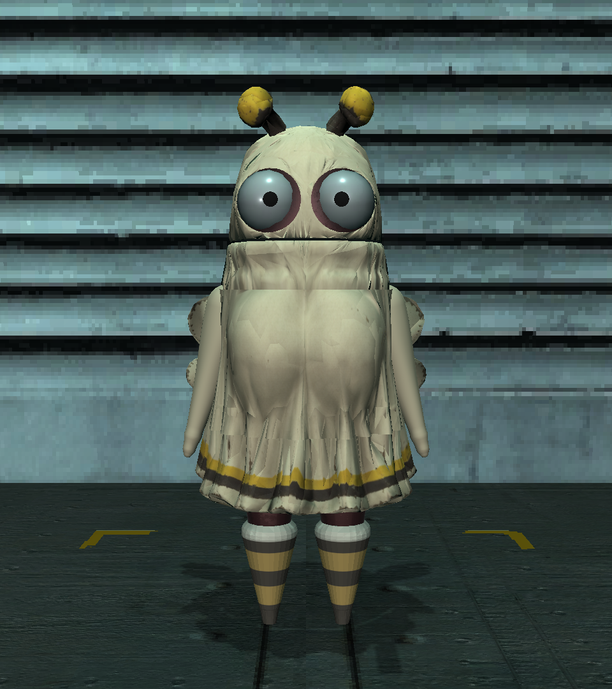
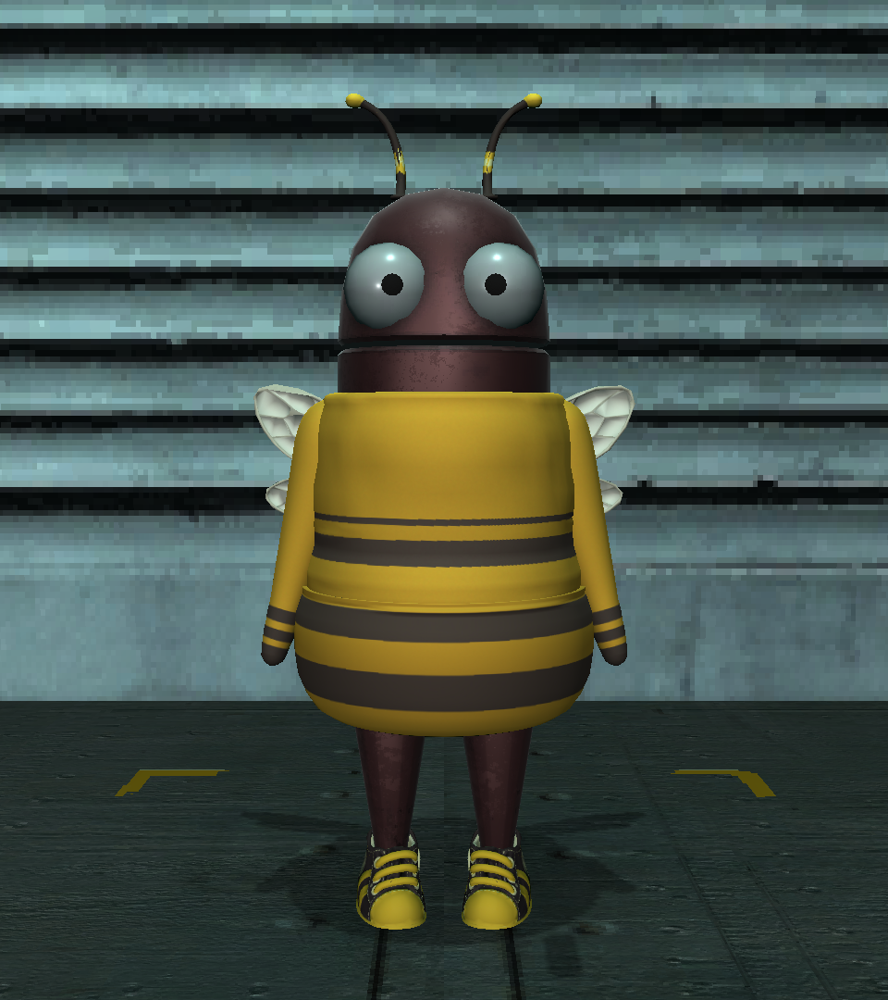
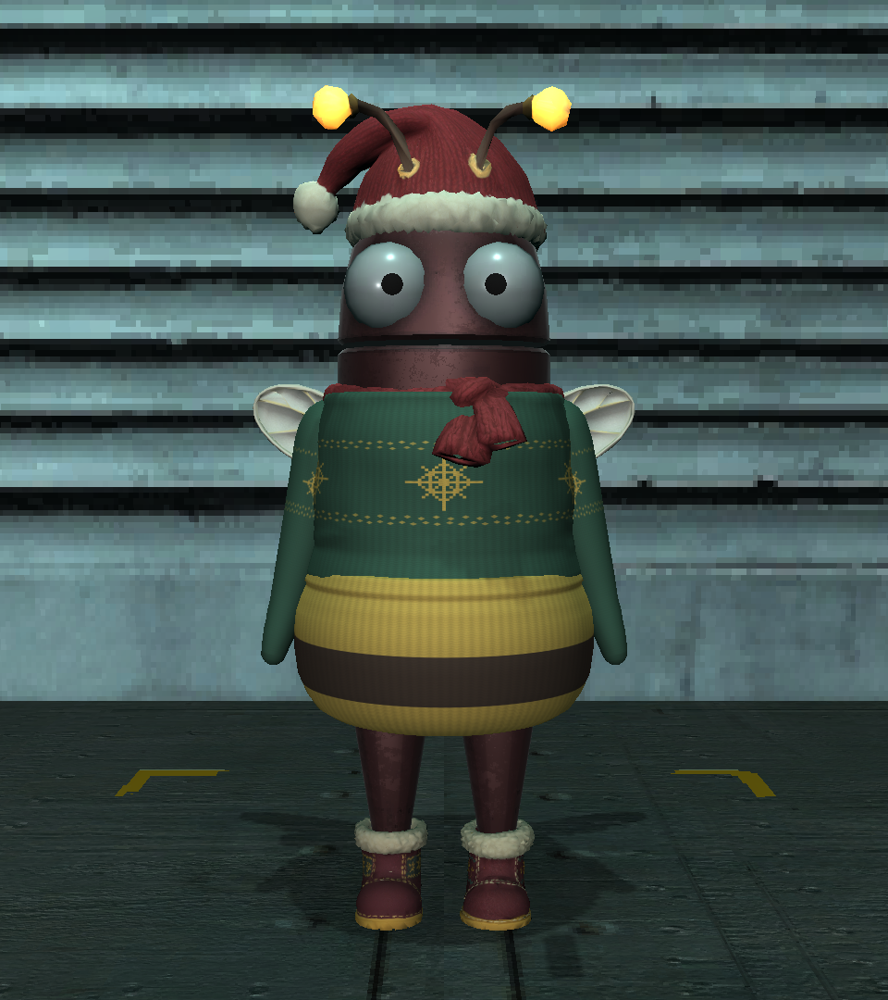

# Boobees Suits

Three outfits for Semibots in R.E.P.O. 0.5.4. This build was checked against the game's Unity 6.3 managed assemblies. In-game testing is pending.

- **Boo-Bee** includes ten ghost-bee pieces with a two-part hood, animated bodice, wings and striped socks.
- **Sneaker Bee** includes eight pieces with a golden sweater, full sleeves, striped abdomen, wings, antennae and sneakers.
- **New Year Bee** includes nine pieces with a Santa cap and glowing antenna lights, scarf, snowflake sweater, full sleeves, striped abdomen, frosted wings and winter boots.

Find all three sets in Customize. Each piece can be equipped separately. Wings appear under Lower Body Overlay. For co-op, use the same mod version on all clients.

## Screenshots

### Boo-Bee

### Sneaker Bee

### New Year Bee

